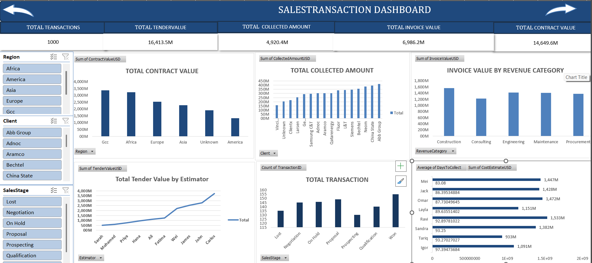
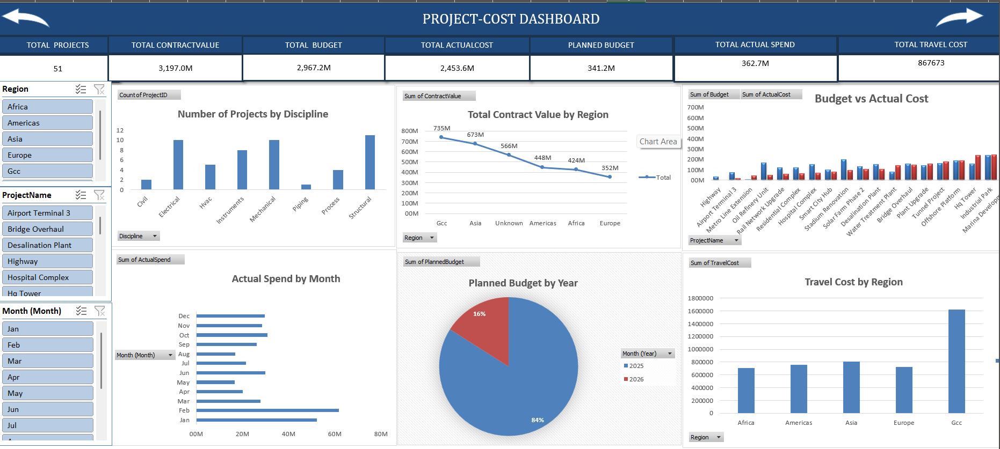
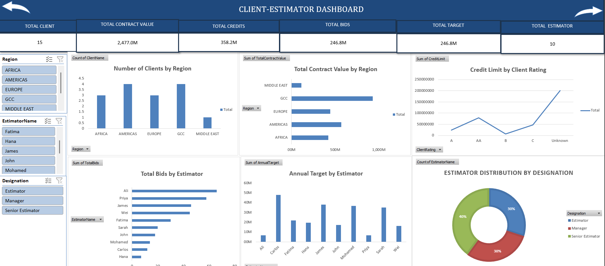

# Construction Sales Analysis

Excel Data Analytics Project from my Data GUC internship.

Cleaned and transformed construction sales, project, client, estimator and cost data using Power Query. Created Pivot Tables, Pivot Charts, slicers and interactive dashboards.

## Tools Used
- Microsoft Excel
- Power Query
- Pivot Tables
- Pivot Charts
- Excel Dashboards

## Project Areas
📊 Sales Analysis
🏗️ Projects & Costs Analysis
👥 Client Analysis
📈 Estimator Performance Analysis

## Project Dashboards

### 1. Sales Dashboard

### 2. Project-Cost Dashboard

### 3. Client-Estimator Dashboard

